# Kinda Smart Box s

    

---

## Project Overview

- **What is it?**  Its small box, which lets you control external light strip and external extruder fan. (Or anything that runs on 5-24V DC)

- **Why does it exist?** Coz  my old setup with mechanical swithces was a total mess and with this I can control the light from mobile from google Home! 

## Why I Made This

This was my old box. 

  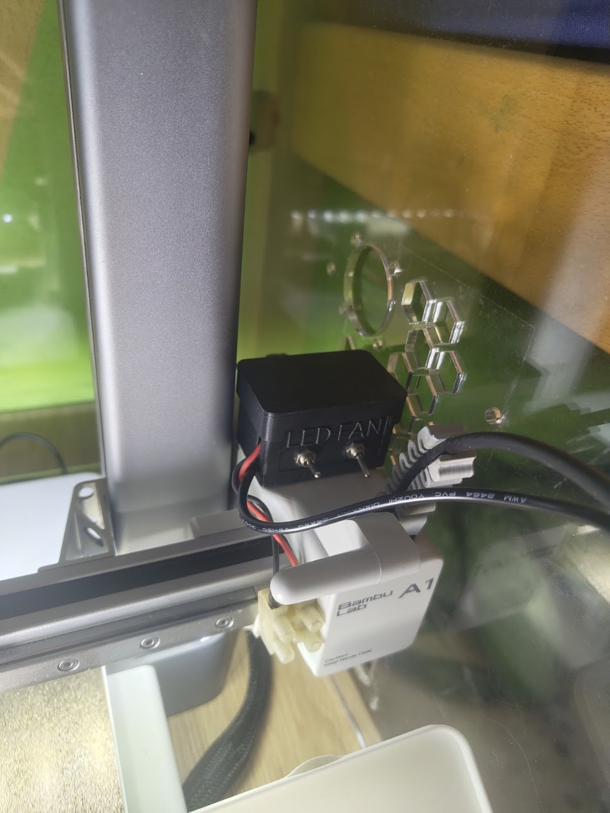
  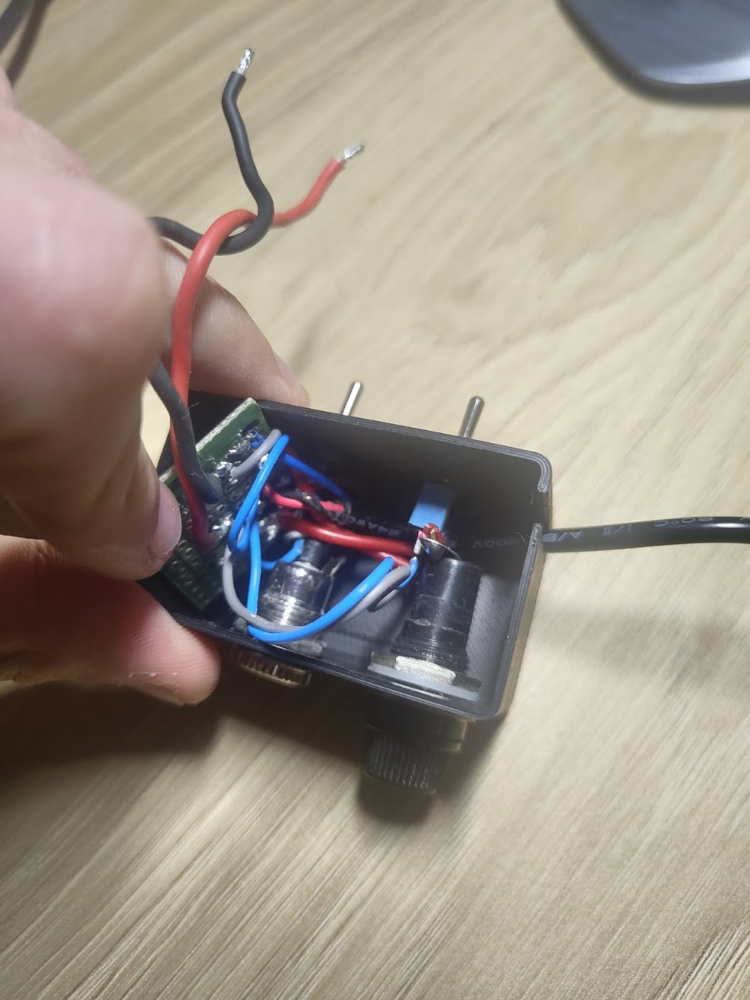

It was working great but i hated to always manualy turn lights or fan extruder...

So that why I creaed a small PCB for it, so it is not as messy as old setup, with ESP32-C3 and IRLZ44N mosfets that can control these peripherals. These are all the features:

1. **Very Smart:** Its connected to internet and it could be controlled anywhere from the world with google home or ESP RainMaker app from Espressif
2. **Fuse:** My printet can output maximum of 500mA so there is fuse pocket to protect printer if something bad happens.
3. **PWM:** Mechanical switches could only turn it ON and OFF. With this I can control the Exact Brightness i need for light or speed of the fan.

---

## Project Gallery

### 3D PCB Renders

  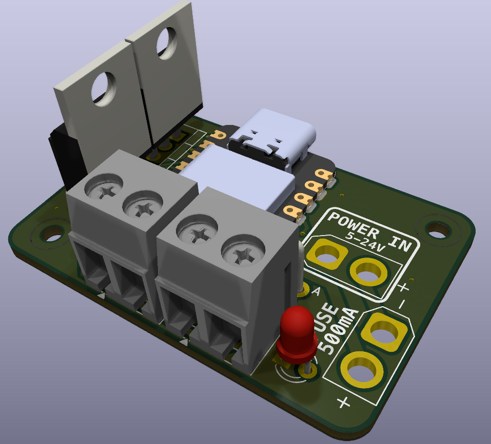
  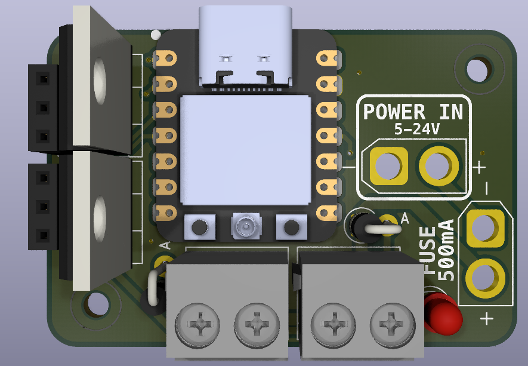

### 3D Board Views

  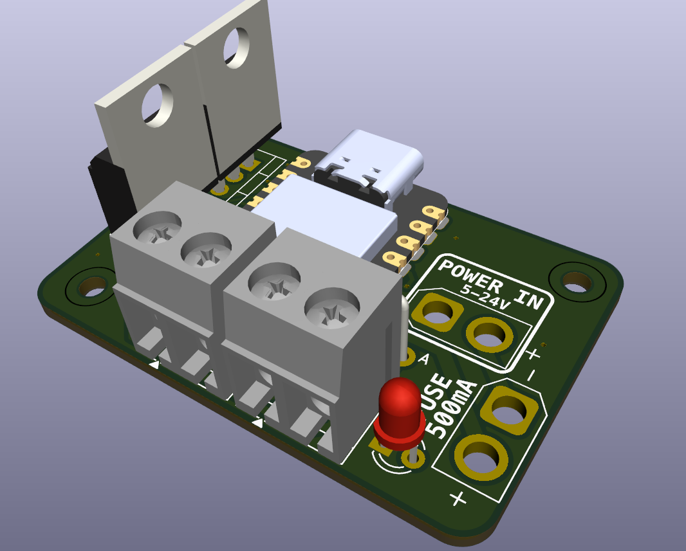
  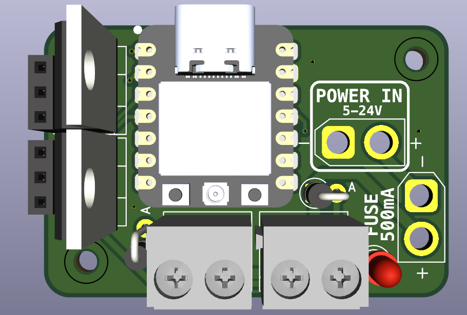

### PCB Layout & Schematic

  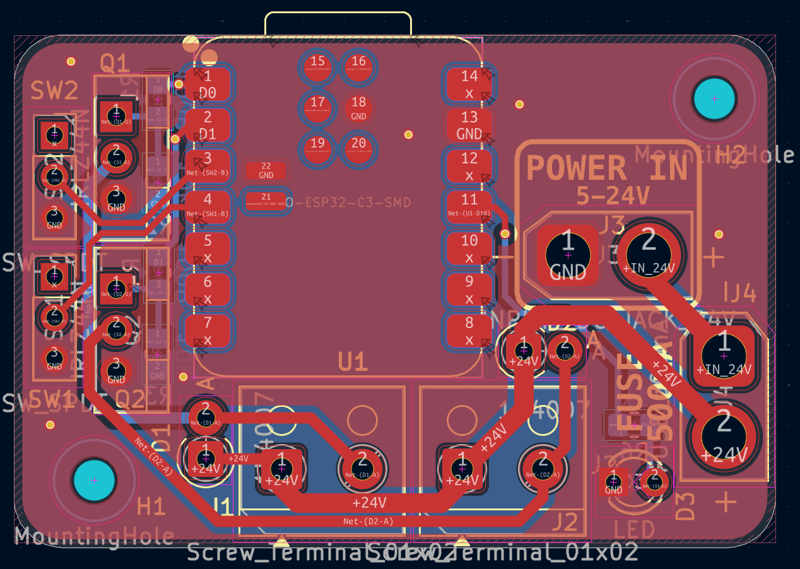
  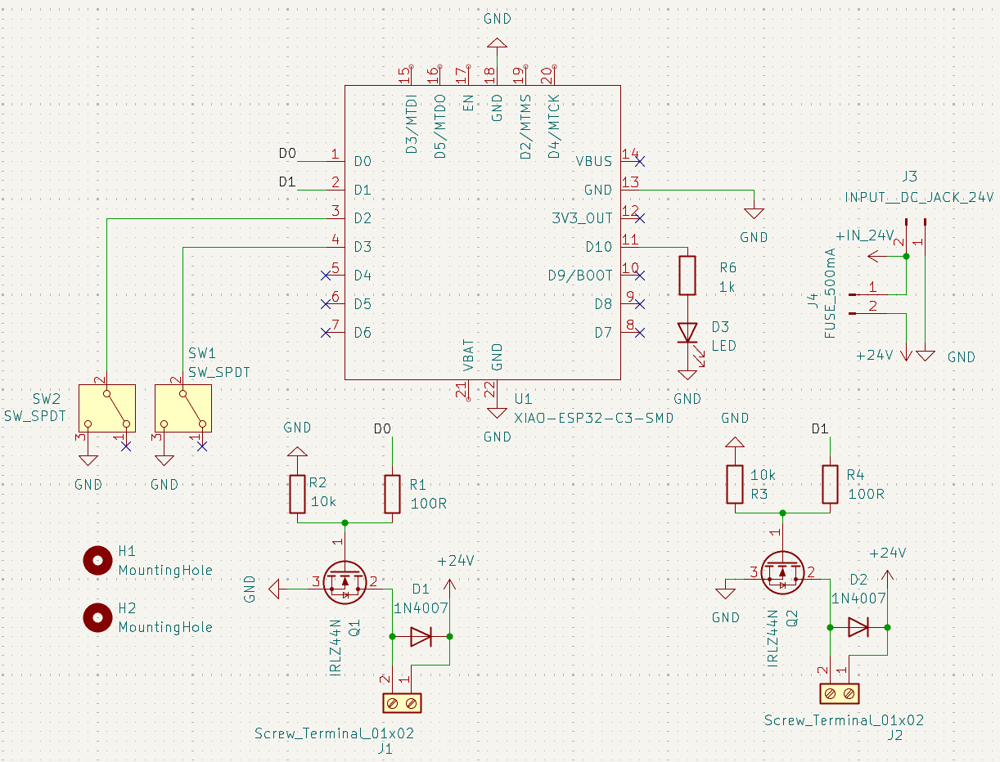

### 3D Enclosure (Fusion 360)

*3D printable case is made in Fusion 360. All CAD files are in the CAD/ folder.*

  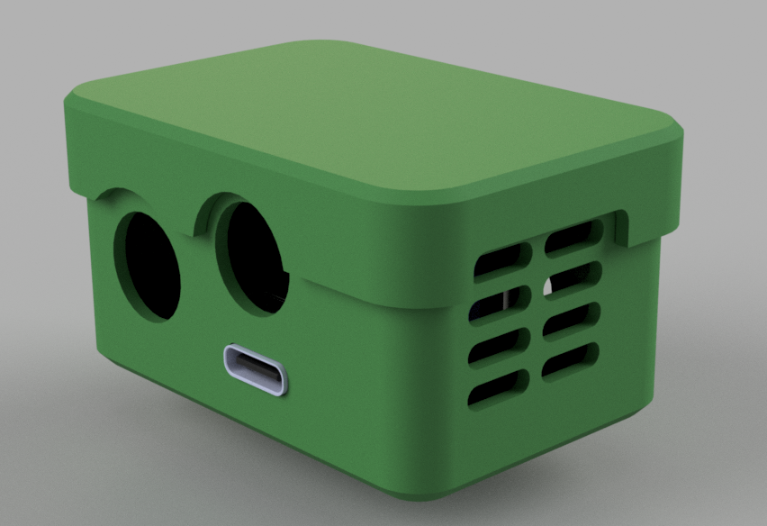
  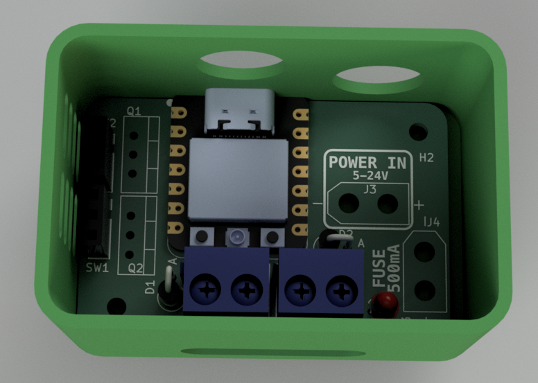

  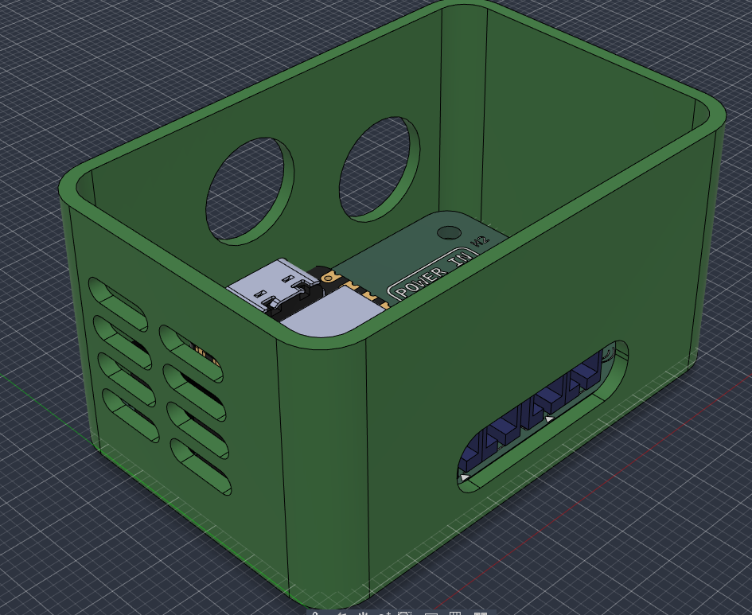
  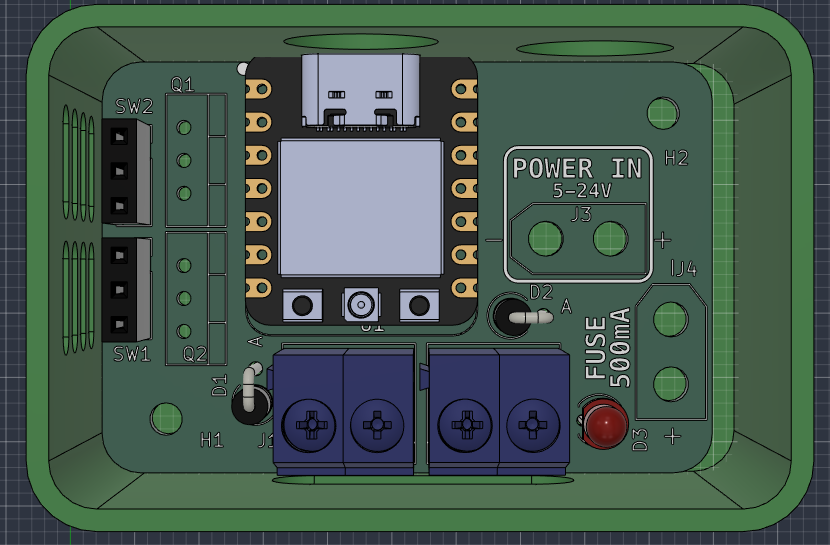

  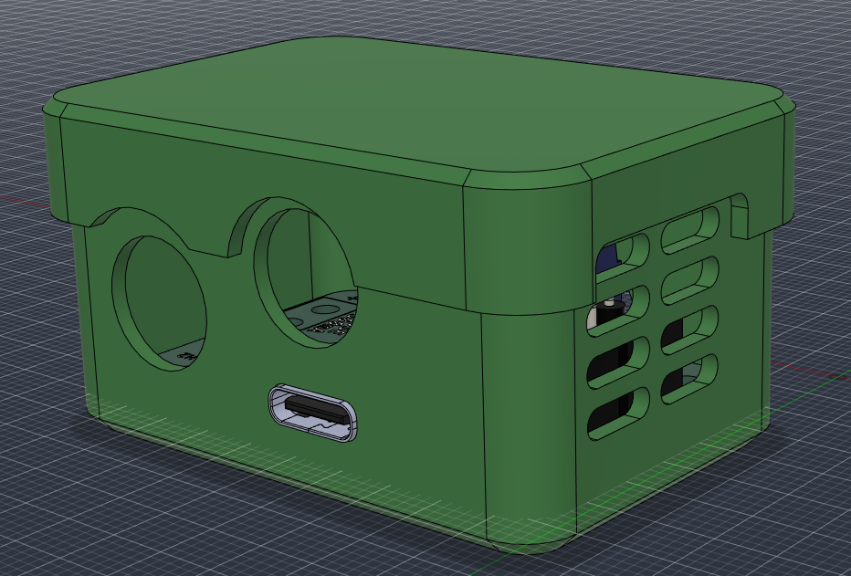

---

## Assembly Guide

### Required Tools & Materials

- Soldering iron 
- Some good solder wire
- Solder flux 
- some good Tweezers for picking up these small Resisotrs and capacitors 
- 3D Printer (for printing case if you want

### Assembly Steps

1. **Start with small components:**
   - All resistors.
   - Just use tweeters and solder 1 pin, check if its correctly alligned and then solder the second :D (Some rezistors are at the bottom side of PCB - Dont forget about them)
2. **LED and DIODES:**
   - Solder the red led but and make sure it has correct polarity.
   - Also solder the 2 1N4007 diodes vertiacaly and make sure th polarity is correct. Otherwise some bad things will happen :|
3. **Mosfets**
   - Solder both mosfets (also with correct orientation ofcourse) and cut the legs under the board so they fit in case
4. **Final:**
   - Place the PCB into the case.
5- DONE

---

## Firmware & Software Setup

###### 1. Arduino IDE Setup

- Install the **esp32** package by Espressif in Boards Manager.

- **Board:** XIAO_ESP32C3

- **Partition Scheme:** RainMaker 4MB  (**IMPORTANT**)

- **USB CDC On Boot:** Enabled

### 2. Flashing XIAO ESP32-C3

- Connect XIAO ESP32-C3 to PC and select the correct COM port in arduino IDE.

- Open `Firmware/code/code.ino` and click **Upload**.

- The red LED turns ON (waiting for Wi-Fi connection).

### 3. Pairing & Google Home Integration

- Open the **ESP RainMaker** app -> tap **+ Add Device** -> **BLE**.

- Select **`PROV_XIAO_SWITCH`**, enter PIN **`12345678`**, and select your Wi-Fi in list.

- The red LED turns OFF once connected; **Bambu Light** and **Bambu Extruder Fan** appear in the app.

- In the **Google Home** app: go to **Devices** -> **+ Add** -> **Works with Google** -> link your **ESP RainMaker** account.

## Bill of Materials

| Reference    | Qty | Value                | Footprint                                                             | link                                                                                                                         | Cost ($)  |
|:------------ |:---:|:-------------------- |:--------------------------------------------------------------------- | ---------------------------------------------------------------------------------------------------------------------------- | --------- |
| D1, D2       | 2   | 1N4007               | Diode_THT:D_DO-41_SOD81_P2.54mm_Vertical_AnodeUp                      | [TME.eu](https://www.tme.eu/cz/details/1n5819-dio/diody-schottky-tht/diotec-semiconductor/1n5819/)                           | 0,62 $    |
| D3           | 1   | LED                  | LED_THT:LED_D3.0mm                                                    | [TME.eu](https://www.tme.eu/cz/details/l-934lid/diody-led-tht-kulate/kingbright-electronic/)                                 | 0.11      |
| J1, J2       | 2   | Screw_Terminal_01x02 | TerminalBlock_RND:TerminalBlock_RND_205-00001_1x02_P5.00mm_Horizontal | [TME.eu](https://www.tme.eu/cz/en/details/dg301-5.0-2p12/pcb-terminal-blocks/degson-electronics/dg301-5-0-02p-12-00a-h/)     | 0.44      |
| J3           | 1   | INPUT__DC_JACK_24V   | Connector that will be mounted to CASE and wired by wire to PCB       | [TME.eu](https://www.tme.eu/cz/en/details/pc-gm2.5/dc-power-connectors/ninigi/)                                              | 4.24      |
| J4           | 1   | FUSE_500mA           | Connector that will be mounted to CASE and wired by wire to PCB       | [TME.eu](https://www.tme.eu/cz/en/details/r3-12e/panel-mount-fuseholders/sci/)                                               | 2.27      |
| Q1, Q2       | 2   | IRLZ44N              | Package_TO_SOT_THT:TO-220-3_Vertical                                  | [TME.eu](https://www.tme.eu/cz/en/details/irlz44npbf/tht-n-channel-transistors/infineon-technologies/)                       | 3.75      |
| R1, R4       | 2   | 100R                 | Resistor_SMD:R_0805_2012Metric_Pad1.20x1.40mm_HandSolder              | [TME.eu](https://www.tme.eu/cz/en/details/crcw0805100rfktabc/smd-resistors/vishay/)                                          | 0.027     |
| R2, R3       | 2   | 10k                  | Resistor_SMD:R_0805_2012Metric_Pad1.20x1.40mm_HandSolder              | [TME.eu](https://www.tme.eu/cz/en/details/crcw080510k0fkea/smd-resistors/vishay/)                                            | 0.027     |
| R6           | 1   | 1k                   | Resistor_SMD:R_0805_2012Metric_Pad1.20x1.40mm_HandSolder              | [TME.eu](https://www.tme.eu/cz/en/details/rc0805fr-071k/smd-resistors/yageo/rc0805fr-071kl/)                                 | 0.068     |
| SW1, SW2     | 2   | SW_SPDT              | Connector_PinSocket_2.54mm:PinSocket_1x03_P2.54mm_Vertical            | [TME.eu](https://www.tme.eu/cz/en/details/bsi-10/slide-switches/sungmun-electronics/ssi-10/)                                 | 1.40      |
| U1           | 1   | XIAO-ESP32-C3-SMD    | Seeed_Studio_XIAO_Series:XIAO-ESP32-C3-SMD                            | [TME.eu](https://www.tme.eu/cz/en/details/seeed-113991054/development-kits-for-data-transmission/seeed-studio/xiao-esp32c3/) | 7.71      |
| PCB          |     |                      |                                                                       | jlcpcb.com                                                                                                                   | 9.45      |
| Shipping TME |     |                      |                                                                       |                                                                                                                              | 7.76      |
| **TOTAL**    |     |                      |                                                                       |                                                                                                                              | **37.87** |

> Btw you can import every components that is from TME directly to TME cart with this file: [quick_order_TME.csv](PCB/quick_order_TME.csv) 

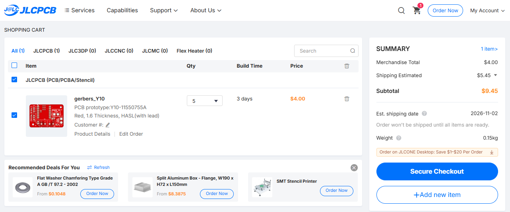

---

## How to Use

1. **Power:** Connect 12-24V power supply do DC JACK and 5V UCBC
2. **Wifi:** Wait a few second and it will automatically connect to wifi (after first setup)
3. **Use it :D** now you can say: "Hey google, Turn on my light on printer."  

---

- Designed by **Šámot** in [Hack Club Forge](https://forge.hackclub.com/projects/3035) project.
